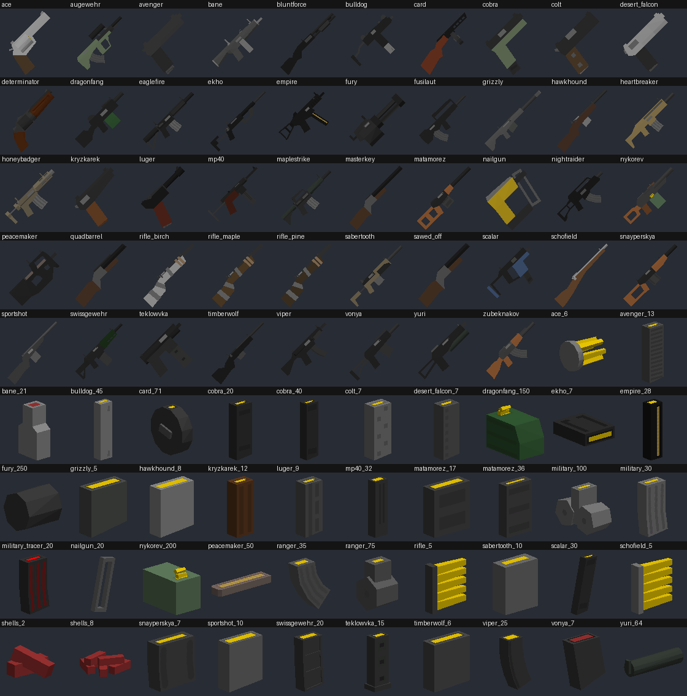

# UnturnedCraft

Unturned-elemek a Minecraftban (Java Edition 26.3, NeoForge 26.3.0.58-beta).
Jelenlegi verzió: **0.3.0**. Az Unturned **48 fegyvere** és a hozzájuk való **42 tár** van benne, az
eredeti modellekkel, textúrákkal, hangokkal és számokkal.



A teljes lista a számokkal együtt: [docs/fegyverek.md](docs/fegyverek.md).

## Mit tud most

| Gomb | Mit csinál |
| --- | --- |
| **Bal klikk** | Lövés. Félautomata fegyvernél egy kattintás egy lövés; automatánál elég nyomva tartani. |
| **Jobb klikk (nyomva tartva)** | Célzás: a fegyver a szemed elé emelkedik, a kép ránagyít, a szórás lecsökken. |
| **R** | Újratöltés az első olyan tárból, ami a táskádban van és illik a fegyverbe. A gomb átállítható a játék billentyűbeállításai között, az UnturnedCraft csoportban. |

- **Honnan vannak a fegyverek:** a kreatív menü UnturnedCraft füléről (elöl a fegyverek, utánuk a tárak),
  vagy paranccsal, pl. `/give @s unturnedcraft:eaglefire`. Túlélő módban egyelőre csak az 1911 és a tára
  készíthető el; a többi fegyver megszerzése a 3. lépés (loot) dolga lesz.
- **Találat:** a golyó azonnal talál (nincs repülő lövedék), ahogy az Unturnedben. A lőtáv fegyverenként
  20 és 300 blokk között van.
- **Sebzés:** az Unturned értékei, a Minecraft 20-as életerejére átszámolva. Fejre több, lábra kevesebb.
  A legtöbb fegyverrel a zombi 2 testlövés vagy 1 fejlövés.
- **Tárak kaliber szerint:** egy fegyverbe több tár is illhet. Az Eaglefire-be például a 30-as katonai tár
  mellett a 100-as dobtár is belefér, és újratöltés után a fegyver annyi lövést tart, amennyi abban a
  tárban van. A fegyver leírása (ha ráviszed az egeret) megmutatja, melyik tár van benne.
- **Sörétes fegyverek:** egy lövés több sörétet lő ki (3-8 darabot), mindegyik külön szóródik és külön
  sebez. Közelről pusztító, távolról alig talál.
- **Automata fegyverek:** 20 ilyen van. A tűzgyorsaság az Unturnedé (a Bulldog másodpercenként 20-at lő).
- **Tolózáras, pumpás és billenőcsöves fegyverek:** egy kattintás egy lövés, de két lövés között hosszabb
  a szünet (a mesterlövész puskáknál 1 másodperc).
- **Távcső:** az Augewehr 4-szeres távcsővel jön. Célzáskor a kép négyszeresére nagyít, az egér ennek
  megfelelően lelassul, a fegyver pedig eltűnik a képből, hogy ne takarjon.
- **Szórás:** csípőből pontatlan, célozva pontos. A célzás fegyvertől függően 0,15-0,6 mp alatt "áll be",
  addig még a csípőszórás él.
- **Célzás közben** nem lehet sprintelni, és a szokásos sebesség 75%-ával mozogsz.
- **Üres fegyverrel** a bal klikk csak kattan, és kiírja, melyik gomb az újratöltés. Újratölteni bármikor
  lehet, ha nincs tele a tár. Kreatív módban nem fogy a töltény, és tár sem kell az újratöltéshez.
- **Fegyverrel a kézben a bal klikk nem üt és nem tör blokkot.**
- **Receptek:** 1911 = 4 vasrúd + 1 deszka (`III` / ` IP`), 1911 tár = 1 vasrúd + 1 puskapor.

## A nagy kép: hogyan lesz az Unturned fájljaiból Minecraft-fegyver

A 0.2.0-ban egyetlen fegyver volt, és minden fájlja kézzel készült. 48 fegyvernél ez nem járható, ezért
a 0.3.0 két részre bontja a munkát:

```
 Unturned telepítés                    GENERÁTOR (Python, tools/)                A MOD (Java, src/)
 --------------------                  --------------------------                -------------------
 Bundles/Items/**/*.dat    --------->  unturned_dat.py                           GunDefinitions
   (számok, szöveges)                    |                                         ^  beolvassa induláskor
 Bundles/core.masterbundle --------->  unturned_bundle.py                          |
   (modell, textúra, hang)               |                                       unturnedcraft_guns.json
                                         v                                         ^
                                       extract_unturned_assets.py  ----------------'
                                         |  (eldönti, mi támogatott; összerakja a fegyvert)
                                         v
                                       minecraft_model.py  ------->  assets/unturnedcraft/
                                         (kiszámolja a tartást)        models, textures, sounds, items, lang
```

1. **A generátor** egyszer fut le a te gépeden (nem a játékban). Végigmegy az Unturned összes fegyverén, és
   mindegyikhez legyártja a Minecraft fájljait a `src/main/resources` alá. Ezek a fájlok bekerülnek a
   repóba, ezért a mod buildeléséhez **nem kell** újra futtatni, és Python sem kell hozzá.
2. **A mod** nem tud a fegyverekről név szerint. Induláskor beolvassa a generátor által írt
   `unturnedcraft_guns.json` fájlt, és ami abban van, azt regisztrálja. A kezelés (lövés, célzás,
   újratöltés) egyetlen közös osztály, a `GunItem`, ami minden fegyverre ugyanaz, csak a számai mások.

Ezt hívják **adatvezérelt** felépítésnek: a kód az "hogyan", az adat a "mit". Új fegyverhez nem kódot kell
írni, hanem adatot kell adni.

## A generátor részletesen

### 1. Számok: a `.dat` fájlok (`tools/unturned_dat.py`)

Az Unturned minden tárgyat egy sima szöveges fájllal ír le. Az Eaglefire-é
(`Bundles/Items/Guns/Eaglefire/Eaglefire.dat`) például így néz ki, kivonatosan:

```
Type Gun
ID 4
Sight 5              <- az alap irányzék tárgy-azonosítója
Magazine 6           <- az alap tár tárgy-azonosítója (ez a Military_30)
Semi                 <- kapcsoló: csak a jelenléte számít
Caliber 1            <- milyen kaliberű tár megy bele
Range 200
Firerate 4           <- két lövés között ennyi Unturned-tick telik el (az Unturned 50-et számol másodpercenként)
Action Trigger       <- működési mód
Zombie_Damage 99
Zombie_Spine_Multiplier 0.6
Spread_Aim 0.05
Spread_Angle_Degrees 5.71
```

A formátum soronként `Kulcs érték`. Ha egy sorban csak kulcs áll (`Semi`, `Auto`), az kapcsoló. A tárak
ugyanilyen fájlok (`Amount 30`, `Calibers 1`, `Caliber_0 1`, sörétesnél `Pellets 6`).

A fájlok egymásra **azonosítóval hivatkoznak** (`Magazine 6`), ezért a generátor először beolvassa az
összes fegyvert, tárat, irányzékot, csővéget, markolatot és taktikai kiegészítőt, és azonosító szerint
szótárba teszi őket.

### 2. Modellek: az asset-csomag (`tools/unturned_bundle.py`)

A modellek, textúrák és hangok egy Unity asset-csomagban vannak (`Bundles/core.masterbundle`), ezt a
[UnityPy](https://github.com/K0lb3/UnityPy) könyvtár tudja megnyitni. Három fogalom kell hozzá:

- **Prefab:** egy tárgy "összerakott" formája, csomópontok fája. Egy csomóponton lehet modell (mesh), de
  lehet üres is.
- **Hook:** az üres csomópontok segédpontok. A fegyveren a `Magazine` azt jelöli, hova kerül a tár, a
  `Sight` azt, hova az irányzék, a `View` azt, hova teszi az Unturned a kamerát célzáskor.
- **LOD** ("level of detail"): ugyanaz a modell több részletességben, hogy távolról olcsóbb legyen
  kirajzolni. Nekünk mindig a legrészletesebb (LOD0) kell, a többit a generátor kihagyja. A kikapcsolt
  csomópontokat is kihagyja (ilyen például a távcső lencséje).

**Egy fegyver több prefabból áll össze.** Az Unturnedben a fegyver, a tár és az irányzék külön tárgy, és a
játék futás közben illeszti össze őket. A generátor ugyanezt csinálja, csak egyszer, előre: a fegyver
prefabjából kiolvassa a hookok helyét és állását, majd az alap tár, irányzék, csővég, markolat és taktikai
kiegészítő prefabját a megfelelő hookra "teszi", és az egészet egyetlen `.obj` modellbe írja. Ezért látszik
az Eaglefire-ön a tár és az irányzék, a Maplestrike-on a piros pontos irányzék, az Augewehren a távcső.

**Koordináták.** Két dolgot kell átváltani:

- A Unity balkezes koordináta-rendszert használ, a Minecraft jobbkezest. Az átváltás az X tengely
  tükrözése; ilyenkor a háromszögek körüljárási irányát is meg kell fordítani, különben a modell
  "kifordulna" (a belseje látszana).
- A fegyvert úgy kell forgatni, hogy a csöve a Minecraft "előre" iránya, a -Z felé nézzen, a teteje pedig
  felfelé. Ez minden fegyverre ugyanaz a fix forgatás (`ITEM_SPACE` az `unturned_bundle.py`-ban). A prefab
  saját gyökérforgatása erre nem jó: fegyverenként más, és a fegyverek egy része rossz irányba állna tőle.

**Textúrák.** A Minecraft az összes tárgy textúráját egyetlen nagy közös képre ("atlasz") pakolja, ebből
három szabály következik, ezeket a `prepare_texture` intézi:

- A textúrakoordináták nem lóghatnak ki a 0..1 tartományból. Unityben ilyenkor a kép ismétlődik,
  Minecraftban a szomszéd tárgy képe látszana. Ha kilógnak, a generátor annyiszor másolja egymás mellé a
  képet, ahányszor kell, és a koordinátákat ehhez igazítja.
- A kép négyzetes, kettőhatvány méretű és legalább 16×16-os legyen. Az Unturned sok textúrája csak pár
  képpontos színpaletta (pl. 4×2). A felnagyítás "legközelebbi szomszéd" módszerrel megy, így a színek nem
  mosódnak össze.
- Az egyszínű, textúra nélküli anyagok egy közös kis képet kapnak a színük nevével (pl. `flat_323232.png`),
  így ugyanaz a szürke nem kerül be ötvenszer.

**Hangok.** Lövés, újratöltés és az üres fegyver kattanása (az Unturnedben `hammer`). A generátor mono OGG
fájlba írja őket, mert a Minecraft csak a mono hangot helyezi el térben. A hangtompítós fegyvereknek nincs
saját lövéshangjuk: azt a csővégük (a `Barrel` kiegészítő) adja. Öt fegyvernek nincs kattanáshangja, ezek
az 1911-ét kapják.

### 3. Tartás: hogyan áll a fegyver kézben (`tools/minecraft_model.py`)

A modell `.json` leírásának `display` része mondja meg, hogyan jelenjen meg a tárgy az egyes nézetekben
(kézben belülről, kívülről, a hotbaron, a földön, item frame-ben). Minden nézethez három dolog tartozik, és a
játék ebben a sorrendben alkalmazza őket a modell közepe körül: **méretezés, forgatás, eltolás**.

A 0.2.0-ban ezek a számok az 1911-hez kézzel voltak beállítva. Most a generátor számolja ki őket mind a 48
fegyverhez, a következő ötlettel:

- **Kézben tartva** a fegyver **markolatpontja** kerüljön mindig ugyanoda. A markolatpont az Unturned-modell
  origója: az Unturned is ott fogja a fegyvert. Hogy hol van az "ugyanoda", az a jóváhagyott 1911-es
  tartásból van visszaszámolva (`FIRST_PERSON_GRIP`, `THIRD_PERSON_GRIP`). Így egy pisztoly és egy mesterlövész
  puska markolata ugyanott van a kézben, akármekkora a modell. Az `anchor_translation` függvény éppen ezt
  számolja: mekkora eltolás kell ahhoz, hogy a modell egy adott pontja a forgatás után egy adott helyre
  essen.
- **Célzáskor** a **szem helye** kerüljön pontosan a kamerába, így az irányzék a célkereszt alá esik. A szem
  helyét a generátor ebben a sorrendben keresi: az irányzék `Aim` pontja (az irányzék tudja, hova kell
  nézni), ha nincs, a fegyver `View` pontja (a beépített irányzékú fegyvereknél, pl. a pisztolyoknál), ha az
  sincs, becslés a modell méretéből.
- **A hotbaron** a fegyver oldalnézetben, 45 fokkal megdöntve látszik (az átló hosszabb, mint az oldal, így a
  hosszú fegyverek is kitöltik a négyzetes helyet), a méretét pedig úgy választja meg, hogy éppen beleférjen.
- **Távcsöves fegyvernél** célzáskor a modell egy blokknyit lesüllyed, ki a képből.

A számítás helyességét az ellenőrzi, hogy a képletek az 1911-re pontosan visszaadják a kézzel beállított,
játékban jóváhagyott értékeket.

Az eredmény fegyverenként két modell-leírás: `models/item/<név>.json` (a szokásos tartás) és
`models/item/<név>_aiming.json` (célzás; ez csak a belső nézet eltolását írja felül). Az `items/<név>.json`
választ közülük aszerint, hogy a játékos éppen használja-e a tárgyat (`minecraft:using_item`).

### 4. Melyik fegyver maradt ki, és miért

A generátor csak azt gyártja le, amit a mod kezelni tud; a futás végén kiírja a kimaradtakat az okkal.

| Kimaradt | Miért |
| --- | --- |
| Bow_Birch, Bow_Compound, Bow_Maple, Bow_Pine, Crossbow | Íj és számszeríj: repülő lövedék kell hozzájuk. |
| Launcher_Rocket | Rakétavető: repülő, robbanó lövedék kell hozzá. |
| Shadowstalker | Sínágyú: robbanó lövedéket lő. |
| ShadowstalkerMk2 | Robbanó lőszert lő. |
| Tank_Cannon, Tank_HMG, Tank_HMG_Fighter_Jet | Járműre szerelt fegyver. |
| Cobra_Jam | Nincs saját modellje (a Cobra egy változata). |
| Paintballgun | Az alap tára nem szám-azonosítóval van megadva. |

Tárból minden bekerül, ami nem robbanó, és legalább egy támogatott fegyverbe való.

### 5. A generátor futtatása

Csak akkor kell, ha a generátoron változtatsz, vagy frissült az Unturned. Python 3 kell hozzá:

```
pip install UnityPy numpy pillow soundfile
python tools/extract_unturned_assets.py --unturned "C:\Program Files (x86)\Steam\steamapps\common\Unturned"
```

Nagyjából egy percig fut. A végén ezt kell látnod: `Kesz: 48 fegyver, 42 tar, 141 textura.` (A képernyőre
írt szöveg szándékosan ékezet nélküli, mert a Windows parancssora nem mindig tudja megjeleníteni az
ékezeteket.) Utána `git status` megmutatja, mi változott.

Három dolgot érdemes tudni róla:

- A nyelvi fájlokban (`lang/*.json`) csak a tárgynevek sorait (`item.unturnedcraft.*`) írja újra; a kézzel
  írt sorok (gombok, üzenetek, feliratok) megmaradnak.
- Régi fájlt nem töröl. Ha egy fegyver kikerül a támogatottak közül, a korábbi fájljai a mappában maradnak.
- Az `--only Eaglefire Colt` kapcsolóval csak a felsorolt fegyvereket gyártja le. Ez kísérletezéshez való,
  és csak külön `--project <mappa>` megadásával működik, mert a közös fájlokból (az adatfájl, a hangok
  listája, a nevek) különben kimaradna a többi fegyver.

### 6. Előnézet a játék elindítása nélkül (`tools/preview_models.py`)

```
pip install numpy pillow
python tools/preview_models.py
```

Három áttekintő képet készít a `build/preview` mappába: `gui.png` (hotbar-nézet, ilyen a fenti kép),
`firstperson.png` (kézben tartva) és `aiming.png` (célzás közben, fehér kereszttel a képernyő közepén). Arra
jó, hogy egy generálás után egy pillantással látsszon, ha valamelyik fegyver rossz irányba áll, vagy célzáskor
nem a célkereszt alá kerül az irányzéka. Ez egy kis saját szoftveres rajzoló (háromszögek vetítése,
z-buffer), nem a játéké: a játékos keze nincs rajta, és a fények csak hasonlítanak. Így néz ki a célzó nézet
ellenőrző képe: [docs/celzas.png](docs/celzas.png).

## A mod részletesen

### Adatvezérelt regisztráció

```
unturnedcraft_guns.json  (a jar gyökerében)
        |
GunDefinitions          beolvassa, amikor a Java először használja az osztályt (static blokk)
        |-- MAGAZINES: azonosító -> MagazineStats (kaliberek, lőszer, sörétszám)
        '-- GUNS:      azonosító -> GunStats      (minden más szám)
        |
ModSounds               fegyverenként 3 hangesemény: item.<fegyver>.shoot / .reload / .empty
ModItems                tárak, majd fegyverek regisztrálása ciklusban; kreatív fül
```

Az adatfájlban **nyers Unturned-értékek** vannak (`"firerate": 4`, `"zombies": {"damage": 99, ...}`), az
átváltás a `GunStats.fromJson` dolga. Így az átváltás szabályai egy helyen, a Java-kódban vannak, és ha
változtatsz rajtuk, nem kell újragenerálni semmit:

| Unturned | Minecraft | Szabály |
| --- | --- | --- |
| Sebzés (a játékosnak 100 életereje van) | életerőpont (20-ból) | × 0,2 (`HEALTH_SCALE`) |
| `Firerate` (50 tick/mp) | tick (20 tick/mp) | × 20/50, kerekítve, legalább 1 |
| Újratöltés és célzásra emelés ideje (mp) | tick | × 20, kerekítve |
| Visszarúgás (fok) | fok | × 0,25 (`RECOIL_SCALE`), mert a kamera nem áll vissza magától |
| Irányzék nagyítása (`Zoom`) | látószög-szorzó | `1 / Zoom`; nagyítás nélküli irányzéknál 0,8 |
| Ritkaság (6 szint) | ritkaság (4 szint) | Epic, Legendary és Mythical egyaránt EPIC |

A ritkaság adja a tárgy nevének színét.

### Kaliber és tárak

Az Unturnedben nem az van megadva, hogy "ebbe a fegyverbe ez a tár való", hanem mindkettőnek van
**kalibere** (egy belső szám, nem valódi lőszerméret), és ami egyezik, az összeillik. A fegyvernek egy vagy
több kalibere lehet, a tárnak is. Ebből magától adódik, hogy a katonai tárak (kaliber 1) nyolc különböző
fegyverbe jók.

A modban:

- A tárak `MagazineItem` tárgyak, a számaik a `MagazineStats`-ban vannak. A `fits` metódus dönti el, illik-e
  egy fegyverbe: van-e közös kaliberük.
- A fegyver példánya két saját adatot hordoz (data component, `ModDataComponents`): `AMMO` (hány lövés van
  benne) és `LOADED_MAGAZINE` (melyik fajta tár van benne). Az utóbbi új a 0.3.0-ban, és azért kell, mert a
  fegyver befogadóképessége és a sörétszám már nem a fegyvertől, hanem **a betöltött tártól** függ.
- Újratöltéskor (`GunItem.reload`) a szerver a hotbartól kezdve megkeresi az első illő tárat, elvesz belőle
  egyet, beírja a fajtáját a `LOADED_MAGAZINE`-be, és a töltényszámot a tár befogadóképességére állítja.
- Egy új fegyver az alap tárával, tele jön létre.

A 0.2.0-ban az 1911 tárát `colt_magazine`-nek hívták, most az Unturned mappaneve szerint `colt_7`. Hogy a
régi világokban lévő tárak ne vesszenek el, a `ModItems` aliast jegyez be a régi névre
(`ITEMS.addAlias`): a játék a régi nevű tárgyakat az új néven tölti be.

### Sörét

A sörétes lőszernél a tár `.dat` fájljában ott a `Pellets` sor. Lövéskor a szerver ennyiszer futtatja le
ugyanazt a találatszámítást (`fireBullet`), mindegyiket saját, véletlen szórással, és mindegyik külön sebez.
Egy lövés ettől még egy töltényt fogyaszt, és egy hangot ad.

Egy részlet, ami nélkül ez nem működne: a Minecraft a sebzés után fél másodpercig sérthetetlenné teszi a
lényt, így a második sörét már nem sebezne. A `bullet` sebzéstípus ezért benne van a
`bypasses_cooldown` címkében (`data/minecraft/tags/damage_type/`), ami ezt a védelmet kikapcsolja. Ugyanez
kell az automata fegyverekhez is.

### Automata tűz és a tűzgyorsaság órája

A kliens minden tick elején megnézi (`GunInputHandler.onClientTick`), meg van-e húzva a ravasz:

```java
boolean triggerPulled = clicked || (gun.stats().automatic() && keyAttack.isDown());
```

- `clicked`: az előző tick óta **lenyomták** a gombot. Ez a félautomata viselkedés: egy lenyomás, egy lövés.
- `isDown()`: a gomb **éppen le van nyomva**. Automata fegyvernél ez is elég.

A tempót nem ez adja, hanem a `GunItem.fireRateAllows`: megjegyzi, mikor lőtt utoljára a játékos, és csak
akkor enged új lövést, ha a fegyver várakozási ideje letelt. A 0.2.0 erre a Minecraft beépített "cooldown"
rendszerét használta (az a hotbaron is látszik, ahogy az ender gyöngynél), de egy másodpercenként 10-20
lövést leadó fegyvernél az folyamatosan villogna, és a hálózaton is feleslegesen sok üzenet menne. A
beépített cooldown ezért most már csak az **újratöltés** idejére és az üres kattanás utáni rövid szünetre
szolgál, ahol éppen jó, hogy látszik.

Az "óra" a játékos saját tick-számlálója (`player.tickCount`). A kliensnek és a szervernek külön órája van,
és a kettő nem jár tökéletesen együtt: a kliens 2 tickenként küld egy lövést, de a szerverhez ez néha 1,
néha 3 tick különbséggel érkezik meg. Ezért a szerver 1 tickkel engedékenyebb
(`SERVER_FIRE_RATE_TOLERANCE_TICKS`). Hogy ezzel ne lehessen csalni, a korán érkezett lövést úgy könyveli
el, mintha a rendes idejében jött volna: ami most korábban jött, az a következő várakozásból hiányzik.
Így egy átírt kliens sem tud a fegyver átlagos tűzgyorsaságánál gyorsabban lőni.

A helyi lövés (hang, visszarúgás) előbb fut le, és a kliens **csak akkor** küld csomagot a szervernek, ha a
saját órája szerint a fegyver elsüthető volt. Így nyomva tartott gombnál nem megy fölösleges csomag minden
tickben.

### Távcső

A célzás ránagyítása eddig is megvolt (`onComputeFov`: a látószög a 0,8-szorosára szűkül). Távcsőnél a
szorzó `1 / nagyítás`, az Augewehrnél 0,25. Ehhez két kiegészítés kellett:

- **Egérérzékenység** (`onCalculateTurn`): ha a kép négyszeresére nagyít, ugyanaz az egérmozdulat négyszer
  akkorát mozdítana a célponton. Ezért célzás közben a nagyítás arányában lassul az egér. A játék az
  érzékenység csúszkájának értékéből (s) köbös képlettel számol sebességet, `(0,6·s + 0,2)³`, ezért a
  csúszka értékét nem lehet egyszerűen megszorozni: a kód visszaszámolja, melyik csúszkaérték adja a kért
  arányú sebességet.
- **A modell eltűnik** célzáskor (lásd a generátornál), mert a távcső belseje csak kitakarná a képet. Igazi
  távcső-keret (fekete maszk szálkereszttel) még nincs.

### Kliens és szerver

A Minecraft két félből áll, egyjátékos módban is:

- a **kliens** az, amit látsz és irányítasz (ablak, billentyűk, hang, kamera),
- a **szerver** az, ahol a világ "valójában" van (lények, életerő, tárgyak).

Egyjátékos módban a kettő ugyanabban a programban fut, de külön szálon, és ugyanúgy hálózati
csomagokkal beszélget, mintha két külön gép lenne. Ebből két szabály következik:

1. **Ami számít, az a szerveren történik.** Találat, sebzés, töltényfogyás. Ha ezt a kliens
   döntené el, többjátékos módban csalni lehetne, és mindenki mást látna.
2. **A szerver nem bízik a kliensben.** A kliens csak annyit mondhat: "lőni szeretnék". Hogy tényleg
   lehet-e (van-e fegyver a kézben, van-e töltény, letelt-e a várakozás), azt a szerver a saját
   adataiból ellenőrzi újra.

**Jobb klikk (célzás).** Ezt a Minecraft magától elküldi a szervernek, ezért nem kell hozzá saját
csomag. A célzás a beépített "tárgyhasználat" rendszerre épül, ugyanarra, amivel az íjat felhúzod:
amíg nyomod a gombot, a játékos "használja" a tárgyat (`GunItem.use`). Ezt az állapotot a játék
szinkronban tartja a két oldal között, így a szerver mindig tudja, célzol-e (`GunItem.isAiming`).

**Bal klikk (lövés) és R (újratöltés).** A bal klikk a Minecraftban ütést jelent, az R gombot pedig
a játék nem is ismeri, ezért ezeket a kliensen "eltérítjük" (`client/GunInputHandler`), és saját
hálózati csomagot küldünk róluk (`network/FireGunPayload`, `network/ReloadGunPayload`).

### Egy lövés útja

```
KLIENS (amit látsz)                               SZERVER (a világ)

bal klikk, vagy automatánál nyomva tartott gomb
  |
GunInputHandler.onClientTick
  |
  |-- GunItem.fire  (kliensoldali futás)
  |     |-- letelt a két lövés közti idő? ha nem: itt vége, csomag sem megy
  |     |-- lövéshang azonnal
  |     '-- visszarúgás (kamera)
  |
  '-- FireGunPayload(pitch, yaw) -------------->  ModNetworking.handleFire
                                                    |  ellenőrzés: él? fegyver van a kezében?
                                                    '-- GunItem.fire  (szerveroldali futás)
                                                          |-- tűzgyorsaság a szerver saját órája szerint
                                                          |-- lövéshang a többi játékosnak
                                                          |-- sörétenként: vonal a szemtől; blokk? lény? sebzés
                                                          '-- töltény -1 ---------------> kliens
```

A `GunItem.fire` tehát **kétszer** fut le. A kliensen azért, hogy a hang és a visszarúgás azonnal
megtörténjen, ne a szerver válaszára várva; ezt hívják kliensoldali jóslásnak (prediction). A
szerveren azért, mert a lövés ott történik meg igazából. A töltényszámot a szerver küldi vissza.

A csomagban benne van a nézés iránya is. A szerver ugyanis a játékos forgásáról csak tickenként
(másodpercenként 20-szor) kap hírt, a kattintás pedig két frissítés közé is eshet; így a golyó
pontosan arra megy, amerre a kattintás pillanatában néztél.

## Mi hol van

| Fájl | Mire való |
| --- | --- |
| `tools/extract_unturned_assets.py` | A generátor fő programja: mi támogatott, a fegyver összerakása, a közös fájlok |
| `tools/unturned_dat.py` | A `.dat` fájlok olvasása |
| `tools/unturned_bundle.py` | Modellek, textúrák, hangok kinyerése az asset-csomagból |
| `tools/minecraft_model.py` | `.obj` és `.json` írása, a tartás (`display`) kiszámolása |
| `tools/preview_models.py` | Előnézeti képek a kész modellekről |
| `src/main/resources/unturnedcraft_guns.json` | **Generált.** A fegyverek és tárak számai; ezt olvassa be a mod |
| `src/main/resources/assets/unturnedcraft/items/*.json` | **Generált.** Melyik modell-leírás tartozik a tárgyhoz (fegyvernél: célzol-e) |
| `.../models/item/*.obj`, `*.mtl`, `*.json` | **Generált.** A modell, és az, hogyan áll kézben |
| `.../textures/item/*.png`, `.../sounds/<fegyver>/*.ogg`, `.../sounds.json` | **Generált.** Textúrák, hangok és a hangok bekötése |
| `.../lang/hu_hu.json`, `lang/en_us.json` | A tárgynevek generáltak, a többi sor kézzel írt |
| `src/main/resources/data/` | Receptek, a sebzéstípus és a címkéi (kézzel írt) |
| `src/main/java/hu/unturnedcraft/UnturnedCraft.java` | A mod belépési pontja (mindkét oldalon) |
| `.../GunDefinitions.java` | Az adatfájl beolvasása |
| `.../GunStats.java`, `MagazineStats.java` | Egy fegyver, illetve egy tár számai; az Unturned-értékek átváltása |
| `.../ModItems.java` | A tárgyak regisztrálása ciklusban, a kreatív menü füle |
| `.../GunItem.java` | A fegyver működése: célzás, lövés, tűzgyorsaság, találat, sebzés, újratöltés |
| `.../MagazineItem.java` | A tár tárgy (a leírásában a lőszer- és sörétszám) |
| `.../ModSounds.java`, `ModDataComponents.java`, `ModDamageTypes.java` | Hangok, a fegyver saját adatai, a "golyó" sebzéstípus |
| `.../network/FireGunPayload.java`, `ReloadGunPayload.java` | A két saját hálózati csomag |
| `.../network/ModNetworking.java` | A csomagok bejelentése és szerveroldali kezelése |
| `.../client/UnturnedCraftClient.java` | A mod kliensoldali belépési pontja |
| `.../client/GunInputHandler.java` | Bal klikk és R figyelése, az ütés letiltása, ránagyítás, egérérzékenység |
| `docs/` | A README képei és a fegyverlista |

A `client` csomagra külön szabály vonatkozik: ami benne van, az csak a játék kliensén töltődik be.
A csomagon kívüli kód (pl. a `GunItem`) ezért **nem hivatkozhat** rá, különben egy dedikált szerver
összeomlana, mert ott nincs billentyűzet, képernyő és kamera.

## Ha rosszul áll egy fegyver a kézben

A `models/item/<név>.json` `display` részében minden nézetnek van egy forgatása (`rotation`, fok),
eltolása (`translation`, 1/16 blokk) és mérete (`scale`):

- `firstperson_righthand`: belső nézet
- `thirdperson_righthand`: külső nézet (F5)
- `gui`: hotbar és inventory
- `ground`: eldobva a földön
- `fixed`: item frame-ben

A célzás belső nézete külön fájlban van: `models/item/<név>_aiming.json`.

Kétféleképpen lehet hozzányúlni:

- **Kipróbáláshoz** írd át a számokat közvetlenül a `.json`-ban, és nézd meg az eredményt. (Fejlesztői
  futtatásban, `gradlew runClient`, elég az F3+T a játékban, nem kell újraindítani.) Ezek a fájlok
  generáltak, ezért a generátor következő futása **felülírja** a kézi módosítást.
- **Véglegesen** a `tools/minecraft_model.py` elején lévő állandókat kell átírni (`FIRST_PERSON_GRIP`,
  `FIRST_PERSON_YAW`, `THIRD_PERSON_GRIP`...), és újra futtatni a generátort. Ez minden fegyverre egyszerre
  hat. Ha csak egyetlen fegyverrel van baj, az általában azt jelenti, hogy annak a modellnek máshol van a
  markolatpontja vagy a szem-pontja, mint a többinek; ilyenkor a `generate_gun`-ban érdemes kivételt tenni.

## Buildelés

Kell hozzá JDK (17 vagy újabb; a 25-öst a Gradle magától letölti a fordításhoz), és az első
futás sok mindent letölt, ezért percekig tarthat. A projekt mappájában, parancssorból:

```
gradlew build
```

A kész mod a `build\libs\unturnedcraft-<verzió>.jar` (most `unturnedcraft-0.3.0.jar`). Ezt kell
bemásolni ide: `%APPDATA%\.minecraft\mods\`, aztán a launcherben a **NeoForge** profillal indítani.

**Figyelj rá, hogy a `mods` mappában a modból csak egy változat legyen.** Ha verziót váltasz (a
`gradle.properties` `mod_version` sora), a jar neve is megváltozik, és a régit törölni kell,
különben a játék kétszer találja meg ugyanazt a modot, és hibával leáll.

Gyors kipróbáláshoz másolgatás nélkül: `gradlew runClient` (külön tesztjátékot indít a moddal).

## Új fegyver hozzáadása

- **Egy kimaradt Unturned-fegyver** (íj, rakétavető...): ehhez előbb a modnak kell megtanulnia az új
  működési módot (pl. repülő lövedék). Utána a generátorban fel kell venni a `SUPPORTED_ACTIONS` közé, és
  újra kell futtatni.
- **Egy fegyver számainak átírása:** a `unturnedcraft_guns.json` generált, a kézi módosítást a generátor
  felülírja. Ha az egész modra érvényes szabályt akarsz változtatni (pl. minden fegyver sebezzen többet),
  azt a `GunStats.java` átváltási állandóinál tedd meg. Ha egyetlen fegyvert, akkor a generátorban.
- **Saját, nem Unturned-fegyver:** kell hozzá egy bejegyzés az adatfájlba, a modell fájljai (`.obj`,
  `.mtl`, `.json`, `_aiming.json`), az `items/<név>.json`, három hang a `sounds.json`-ban, és a neve a
  nyelvi fájlokban. Kódot nem kell írni.

## Ismert egyszerűsítések

- **Tüzelési módok:** az Unturnedben sok fegyver átkapcsolható (biztosított, fél, sorozat, automata). Itt
  egy fegyver automata, ha az Unturnedben van automata módja, különben félautomata. Sorozatlövés (burst)
  és mód váltása nincs.
- **Tolózáras, pumpás, billenőcsöves fegyverek:** ugyanúgy működnek, mint a félautomaták, csak hosszabb a
  szünet két lövés között. Nincs külön zárhúzás-hang és -animáció.
- **Tűzgyorsaság:** a Minecraft másodpercenként 20-at számol, az Unturned 50-et, ezért a leggyorsabb
  fegyverek (az Unturnedben 16-25 lövés/mp) egyformán 20 lövés/mp-re kerekednek.
- **Kiegészítők:** az alap tár, irányzék, csővég, markolat és taktikai kiegészítő rá van építve a modellre,
  és nem cserélhető. A más tár betöltése működik, de a modellen nem látszik.
- **Tárak:** újratöltéskor a tár egész darabként fogy el. Ha 3 tölténnyel a fegyverben töltesz újra, az a 3
  elvész, és a kivett tár sem kerül vissza a táskába (az Unturnedben igen).
- **Nyomjelző lőszer** (`military_tracer_20`): sima lőszerként működik, nincs fénycsík.
- **Távcső:** nincs távcső-keret, csak nagyítás.
- A célzó nézetre váltás azonnali, nincs átmenet-animáció; a ránagyítás viszont folyamatos.
- A visszarúgás csak felrántja a kamerát, magától nem áll vissza, ezért az Unturned értékének a negyede.
- Nincs torkolattűz, hüvelykidobás és újratöltés-animáció.
- Külső nézetben (F5) a kar nem emelkedik fel célzáskor.
- A fegyver nem kopik (az Unturnedben igen).

## Hogyan lett ellenőrizve

- A Java-kód a valódi Minecraft 26.3 és NeoForge fájljaival fordul, figyelmeztetés nélkül.
- Egy fej nélküli (ablak nélküli) tesztszerveren egy próbajátékos mind a 48 fegyverrel lőtt egy zombira, és
  a sebzés pontosan annyi, amennyi az Unturned számaiból következik. Ugyanez a teszt végigpróbálta mind a
  2016 fegyver-tár párosítást (81 illik össze), az automata tűz tempóját, a tolózáras fegyverek szünetét, a
  sörétek szóródását, az újratöltés minden ágát és a régi tárnév aliasát.
- A modellek tartása az előnézeti képeken minden fegyverre át lett nézve.
- **Amit csak a játékban lehet megnézni**, és ezért rajtad múlik: a kliensoldali részek (billentyűk, nyomva
  tartott gomb, ránagyítás, egérérzékenység), és az, hogy a modellek a játék saját rajzolójával, kézzel
  együtt is jól állnak-e.

## Változások

**0.3.0**
- 48 fegyver és 42 tár az Unturnedből, automatikusan generálva (korábban csak az 1911).
- A generátor négy modulra bontva; a fegyverre rákerül az alap tár, irányzék és a többi kiegészítő.
- A tartás és a célzó nézet minden fegyverhez számított, nem kézzel állított.
- A mod adatfájlból regisztrálja a tárgyakat (`unturnedcraft_guns.json`).
- Tárak kaliber szerint; a fegyver megjegyzi, melyik tár van benne, és annak a befogadóképességét veszi át.
- Sörétes lőszer: több sörét lövésenként.
- Automata tűz nyomva tartott gombbal; a tűzgyorsaságnak saját órája van.
- Távcsöves fegyver: nagyítás, lassabb egér, a modell eltűnik célzáskor.
- Az 1911 tárának új azonosítója `colt_7` (a régi `colt_magazine` aliasként megmaradt).
- Előnézet-készítő (`tools/preview_models.py`).

**0.2.0**
- Unturned-szerű kezelés: bal klikk lövés, jobb klikk célzás, R újratöltés.
- Valódi félautomata tüzelés.
- Célzó nézet az Unturned `View` pontja alapján, ránagyítással.
- A szórás a célzástól függ (korábban a guggolástól).
- Újratölteni nem csak üres fegyverrel lehet; az üres fegyver nem tölt újra magától.
- Fegyverrel a kézben a bal klikk nem üt és nem tör blokkot.

**0.1.0**
- Az 1911 pisztoly és a tára: modell, textúra, hangok és statok az Unturnedből.

## Fontos

Az Unturned modelljei, textúrái és hangjai a Smartly Dressed Games tulajdonai. Saját gépen, saját
használatra rendben van, de ezekkel a fájlokkal együtt **ne tedd közzé** a modot. A repó ezért maradjon
privát: a generált fájlok (`src/main/resources/assets/`) és a `docs/` képei is Unturned-tartalmak.
